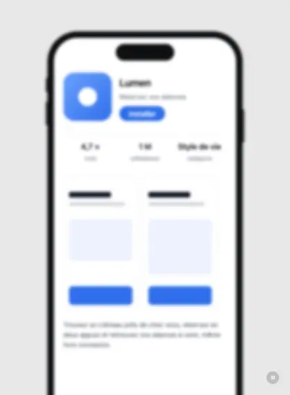
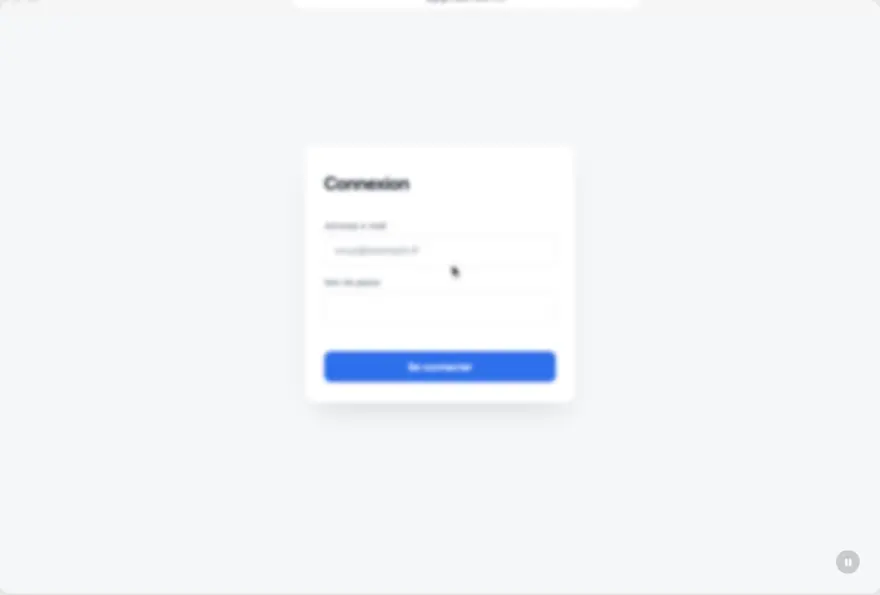

# prototype-anime

Une skill pour Claude et Codex qui fabrique des **prototypes animés d'interface**, joués comme un petit film, sur **mobile** comme sur **desktop** : un téléphone ou une fenêtre de navigateur sur fond gris, un doigt ou un curseur qui appuie, des champs qui se remplissent, des écrans qui se succèdent, une caméra qui zoome sur l'action puis recule.

Elle sert à montrer un parcours sans rien lire : pour un case study, un portfolio, une démo ou un deck.

## Aperçu

<table>
  <tr>
    <td align="center" valign="top"></td>
    <td align="center" valign="top"></td>
  </tr>
  <tr>
    <td align="center">Mobile : le doigt appuie, le clavier se remplit, la caméra suit l'action</td>
    <td align="center">Desktop : le curseur survole et clique, un menu s'ouvre, un message confirme</td>
  </tr>
</table>

Les deux films sont joués par le code de ce dépôt, sur une app imaginaire (« Lumen »). Les sources sont dans [`prototype-anime/reference/`](prototype-anime/reference/) : `exemple-films.tsx` pour le mobile, `exemple-films-desktop.tsx` pour le desktop.

## Installer la skill

Télécharger d'abord [`prototype-anime.zip`](../../releases/latest/download/prototype-anime.zip) (page [Releases](../../releases/latest)), puis suivre la ligne de son outil.

| Outil | Installer l'outil | Installer la skill |
|---|---|---|
| **Claude.ai** (compte Pro) | Rien à installer : [claude.ai](https://claude.ai) | **Réglages**, **Capacités**, **Skills**, puis téléverser le zip tel quel |
| **Claude Code** | [Documentation d'installation](https://code.claude.com/docs/en/setup) : `curl -fsSL https://claude.ai/install.sh \| bash` | `unzip prototype-anime.zip -d ~/.claude/skills` |
| **Codex** | [Documentation d'installation](https://developers.openai.com/codex/cli) : `curl -fsSL https://chatgpt.com/codex/install.sh \| sh` | `unzip prototype-anime.zip -d ~/.agents/skills` |

Puis, dans une nouvelle conversation ou session, demander par exemple : « Fais-moi un prototype animé de ce parcours en version desktop : connexion, tableau de bord, création d'une séance. »

Le **[guide pas à pas](GUIDE.md)** détaille chaque étape pour les trois outils et les deux formats, de l'installation jusqu'au film joué dans un projet, avec les réglages à connaître et un dépannage.

## Ce que contient la skill

```
prototype-anime/
  SKILL.md        la méthode, les règles de rythme (mobile et desktop), le modèle de données
  reference/      le code de référence (React, framer-motion, Tailwind)
    JourneyFilm.tsx        le lecteur du film (device="phone" ou "desktop")
    DeviceMockup.tsx       le cadre : téléphone ou fenêtre de navigateur
    FilmClock.ts           l'horloge partagée (la pause fige tout)
    FilmOverlays.tsx       les gestes : frappe, menus, toasts, défilement, clavier, SMS...
    ScanOverlays.tsx       pulsation, scan de carte
    exemple-films.tsx            deux films mobiles complets d'une app imaginaire
    exemple-films-desktop.tsx    un film desktop complet de sa version web
    VideoCamera.tsx, VideoPlayer.tsx, *.mjs   la caméra sur des vidéos déjà enregistrées
```

## À savoir avant de commencer

- **Dans Claude.ai, Claude produit le code mais ne le fait pas tourner.** Pour voir le film jouer, il faut copier les fichiers dans un projet React ou Next.js (avec Tailwind CSS) sur son ordinateur. Avec **Claude Code** ou **Codex**, l'outil travaille directement dans le projet, le lance et vérifie le résultat : c'est le plus simple pour aller jusqu'au film.
- **Les images d'écran sont à fournir** : des exports en WebP de ton propre parcours, 390 × 844 pixels pour un mobile, 1440 × 900 pixels pour un desktop.
- Les trois outils lisent le même dossier `prototype-anime/` : seul l'emplacement change (`~/.claude/skills/` pour Claude Code, `~/.agents/skills/` pour Codex).

## Licence

[MIT](LICENSE)
